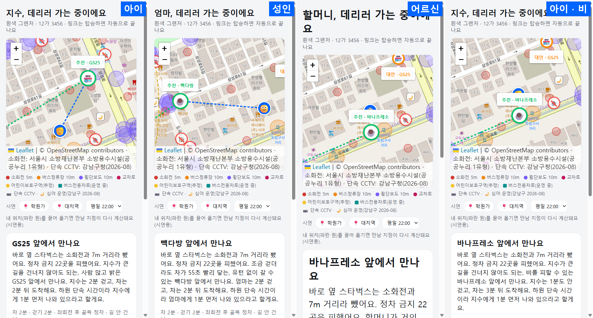

# Tago 픽업 (타고 픽업) · 시연 프로토타입

> 학원 앞 픽업의 마지막 50m를 차가 챙기는 Pleos Connect 앱. 합법적으로 설 곳에서 만나고, 못 서면 바로 다시 정해 아이의 확인을 받고, 탑승은 차가 좌석·문으로 감지하고 아이가 한 번 눌러 확인하면 가족에게 알린다.

## 제출 정보
| 항목 | 내용 |
|---|---|
| 앱 이름 | Tago 픽업 (타고 픽업) |
| 한 줄 소개 | 학원 앞 픽업의 마지막 50m를 차가 챙기는 Pleos Connect 앱 — 합법 만남 지점, 지나치면 자동 재약속, 좌석·문으로 탑승 감지와 아이 확인 |
| APK | [`apk/Meeos_TagoPickup_release.apk`](apk/) (release, 패키지 `ai.meeos.tago`, 앱 내장 엔진으로 단독 실행) |
| 실행 방법 | 아래 [실행](#실행)과 [시연 순서](#시연-순서-데리러-가기-약-1분-40초) |
| 테스트 환경 | 아래 [테스트 환경과 필요한 설정](#테스트-환경과-필요한-설정) |

## 테스트 환경과 필요한 설정
- **에뮬레이터**: Pleos Connect 에뮬레이터(Android Automotive, Android 14 / API 34, x86_64 시스템 이미지) + Virtual Console(`adb forward tcp:8088 tcp:8088` 후 `http://127.0.0.1:8088`)
- **설치**: `adb install -r -g apk/Meeos_TagoPickup_release.apk` — `-g`로 마이크(음성 인식) 등 런타임 권한을 함께 준다. 앱이 쓰는 Pleos 권한: CAR_SEATS·CAR_DOORS·CAR_DRIVE·CAR_WINDOWS·NAVI_ROUTE·NAVI_ROUTE_SEARCH·TTS_SERVICE·STT_SERVICE, AAOS CAR_SPEED
- **기다리는 사람 화면**: `adb forward tcp:8791 tcp:8790` 후 PC 브라우저(휴대폰 크기 권장)에서 `http://127.0.0.1:8791/m/<세션>` 링크를 연다 (링크는 `adb logcat -s Meeos`, 또는 차 화면의 Tago 글자를 길게 누르면 펼쳐지는 개발용 줄에 뜬다). 페이지의 기록(로그)은 `?dev=1`을 붙일 때만 보인다. 보호자 보기는 `/f/<세션>`
- **네트워크**: 지도 타일(OpenStreetMap)과 Leaflet(unpkg CDN)을 받기 위해 에뮬레이터와 PC에 인터넷 연결이 필요하다
- **Virtual Console 팁**: 콘솔 창을 충분히 크게 앞에 띄워 둘 것(창이 작거나 가려지면 페달이 반응하지 않음). 에뮬레이터는 좌석 착석이 항상 true이고 벨트 조작이 없어 탑승은 2열 문 열림→모두 닫힘으로 판정한다(벨트는 `--ez belt_sim true`로 넣는다)
- **소스 빌드**: JDK 17, Android SDK 35, 저장소의 Gradle Wrapper. Pleos SDK는 공개 Maven 저장소(`https://nexus-playground.pleos.ai/repository/maven-releases/`)에서 받는다. `local.properties`에 `sdk.dir`만 있으면 된다
- **PC 시연 서버(선택)**: Python 3.10 이상, 표준 라이브러리만 사용

**Tago 픽업 시연 영상 (2026-10-29 녹화, 1분 53초 — 화면 디자인 정리 전 판)**: [docs/tago_pickup_demo.mp4](docs/tago_pickup_demo.mp4) — 픽업 전용 APK로 녹화. [지수] → 아이 위치 공유 → 제안·"응" → GS25를 서지 못하고 지나침 → 자동 재약속(지수 [확인했어요]) → 도착(탈 문 안내) → 차도 쪽 문이 열리면 인도 쪽 문 안내 → 탑승 감지 → 지수 [제가 탔어요]로 본인 확인, 끝에 조건별 비교(엄마·할머니·비·18시). 차 화면은 에뮬레이터 녹화, 아이 화면은 같은 세션의 웹 페이지, 음성은 앱이 실제로 말한 문장(logcat)을 같은 시각에 PC 음성으로 재현, 주행 구간 5배속. 장면 캡처: [지나침 재약속](docs/30_pickup_replan.png) · [탈 문 안내](docs/31_pickup_road_door.png) · [탑승 감지](docs/32_pickup_boarded.png)

## 구성
| 위치 | 역할 |
|---|---|
| `app/` | Pleos Connect 차량 앱(이 저장소의 기본 빌드는 픽업 판, `gradle.properties` 의 `meeos.edition=pickup`) (Kotlin, Jetpack Compose). 픽업 시작, 차 진행 상황 전송, 제안을 한 문장 음성으로 안내, "응/다른 곳" 음성 인식, 확정 지점으로 순정 내비 안내(NaviHelper `requestRoute`), 2열 전 좌석·양쪽 도어로 탑승/하차 판정, 지나침 자동 재약속·탈 문(인도 쪽) 안내 |
| `app/.../MainActivity.kt` | Android 생명주기·인텐트(Gleo 액션, 시연 훅)·지도 WebView만. 흐름은 아래 컨트롤러에 있다 |
| `app/.../app/` | `AppController`(컨트롤러를 잇고 1초 틱·운전자 말 분배·화면 상태 생성), `Dialog`(한 번에 한 질문: 버튼과 음성이 같은 답으로), `Region`·`Texts`(지역 언어 문자열, 조사 처리), `DemoHooks`·`GleoActions` |
| `app/.../pickup/` | `PickupController`(세션·서버 상태 → 음성·탑승/하차·재약속·정차 한도), `NearbyOffers`(주차장·화장실·드라이브스루·포장 주문 목업), `RoutineScheduler` |
| `app/.../emergency/` · `car/` · `voice/` · `navi/` · `net/` | 응급 브리핑 · 차 신호(Vehicle SDK + 속도) · TTS/STT 줄 세우기와 답 해석 · 순정 내비 연동 · 서버 HTTP 클라이언트 |
| `app/.../ui/` | Compose 화면: `theme/`(토큰: 순정 설정 UI와 같은 흑백·직각, 다크 테마), `components/`(버튼·칩·목록·세그먼트·스테퍼·카드·앞길 스트립·토스트), `screens/TagoScreen.kt`(가로/세로 배치), `UiState.kt`(화면이 그릴 것 전부). 글은 `res/values(-en)/strings.xml` 에만 |
| `docs/ui-design.md` · `docs/ux-writing.md` | 디자인 스펙(토큰·컴포넌트·상태별 화면)과 UX 라이팅 가이드(서비스 톤·용어). 디자인 캔버스(Claude Design): https://claude.ai/artifact/Bcd9Lh5aH51iA4rq5ZdUZX |
| `app/.../engine/` | 앱 내장 엔진(`MeeosEngine.kt`, 서버 엔진을 옮김)과 HTTP 서버(`LocalServer.kt`) — APK 하나로 시연 |
| `apk/` | 제출용 release APK (`Meeos_TagoPickup_release.apk`) |
| `server/meeos_server.py` | 시연 서버: 픽업 세션, 만남 지점 엔진, API (Python 표준 라이브러리만 사용) |
| `server/rider.html` | 기다리는 사람용 무설치 웹(`/m/<세션>`) + 차량 지도 화면(`/car/<세션>`). TMAP Vector JS 바탕(앱키가 있을 때, 주간 ROAD·야간 NIGHT) 또는 Leaflet 1.9.4 + OpenFreeMap 벡터 바탕(MapLibre GL) |
| `server/fetch_daechi_osm.py` | 대치동 학원가 OSM 데이터 수집 (Overpass, 키 불필요) |
| `server/fetch_daechi_extra.py` | 단속 카메라·주정차 차로 태그 OSM 조회 (대치동은 카메라 2건뿐이라 미사용) |
| `server/build_daechi_map.py` | OSM + 서울시 소화전 CSV → `daechi_map.json` |
| `server/fetch_daechi_addr.py` | 대치동 일대 OSM 건물 주소(도로명+번지) 수집 — CCTV 주소를 좌표로 바꾸는 데 씀 |
| `server/build_cctv.py` | 강남구 단속 CCTV 현황 xlsx(+심야·토공휴일 시트) → `daechi_cctv.json` |
| `server/check_parity.py` | PC 서버와 앱 내장 엔진의 결과가 같은지 12개 시나리오로 대조 (현재 12/12 일치) |
| `docs/` | 시연 캡처와 영상 |
| `DATA_SOURCES.md` | 지도·공공데이터 출처와 이용 조건(ODbL, 공공누리 등) |

## 지도 데이터 (대치동 학원가, 도곡로 일대 1.4×1.1km)
| 레이어 | 개수 | 출처 |
|---|---|---|
| 차 경로: 도곡로(동쪽 방향) | 2.06km | © OpenStreetMap contributors (ODbL) |
| 도로 | 112 | OSM |
| 버스정류장 / 횡단보도 / 신호 교차로 | 31 / 83 / 9 | OSM |
| 소화전 | 179 | 서울시 소방재난본부 소방용수시설(2025-12-31), 서울 열린데이터광장 OA-21306, 공공누리 1유형 |
| 학교(어린이보호구역 추정용) | 2 | OSM (이름에 초등학교·유치원·중학교) |
| 만남 후보 (편의점·카페·약국·주차장 입구·지하철 출구) | 84 | OSM |
| 단속 CCTV | 46 (심야 운영 23 · 토·공휴일 21) | 강남구청 「강남구_불법주정차 단속 고정형 CCTV 현황(2026.8.3).xlsx」(구청 주차 안내 페이지 공개 자료). 좌표가 없어 도로명 주소를 OSM 건물 주소에 맞춤(정확 38 · 번지 근사 5 · Nominatim 3), 대치동 5대는 주소로 못 찾아 제외 |

| 공영주차장 (이름·운영 시간·요금) | 6 | 서울특별시 강남구_공영주차장 정보_20250905 (공공데이터포털 15115393, 공공누리 1유형) |
| 역 화장실 | 1 (대치역, 개찰구 안·6번 출구·05–24시) | 서울교통공사_역사공중화장실정보_20260212 (공공데이터포털 15044453). 3호선 일부 행의 좌표가 한 역씩 밀려 있어 위치는 OSM 출입구로 잡고 역명으로 정보를 붙였다 |
| 방범 시설 (보안등 13·112 안내 5·안심벨 3·CCTV 3·노면표기 2) | 26 | 안심귀갓길 안전시설물 통합데이터 (서울 열린데이터광장 OA-21696, 공공누리 1유형, 2023 현장조사) |

재생성: `python server/fetch_daechi_osm.py daechi.json` → `python server/build_daechi_map.py daechi.json 소방용수시설.csv server/daechi_map.json`
CCTV: `python server/fetch_daechi_addr.py addr.json` → `python server/build_cctv.py 강남구_CCTV현황.xlsx addr.json server/daechi_cctv.json`
근처 장소·방범: `python server/build_daechi_extra.py 공영주차장.csv 역화장실.csv 시설물(확장자 없이)`

## 해외 지역 (현대차 해외 판매 상위 3개국)
2025년 현대차 소매 판매 기준 미국(984,017대)·인도(574,536대)·캐나다(154,405대). 근거는 `research_notes/글로벌 확장/hyundai_export_markets.md`

| 지역 | 동네 (OSM) | 차 경로 | 정차 규칙 (프로필 `server/regions/<id>.json`) | 언어·음성 |
|---|---|---|---|---|
| 대치동 | 대치동 학원가 | 도곡로 2.06km | 도로교통법 제32조(기존 그대로) | 한국어 |
| 미국 어바인 | Northwood | Irvine Boulevard 2.2km | 횡단보도 접근 20ft·소화전 15ft·버스 연석 정차 금지(CVC §22500, §22514), 학교 입구 15m | 영어 en-US |
| 캐나다 마컴 | Unionville | Main Street Unionville 1.5km | 버스정류장 12m 정차 금지 / 소화전 3m·교차로 9m·신호 15m는 **잠깐 태우기만**(York Region By-law 2023-34) | 영어 en-US |
| 인도 구루그람 | Sector 43 | Sector 30M Wide Road 1.7km | 모든 규칙이 주차 금지(잠깐 태우기 가능), 큰길 연석 제외(Rules of the Road Reg. 15). 법에 거리가 없어 10–15m는 제품 기본값 | 영어 en-US (Pleos에 힌디어 없음) |

- 규칙마다 `ban`이 `stop`(정차 금지 → 후보 제외)인지 `pickup`(주차만 금지 → 후보로 두되 기다리지 않고 바로 태움, 정차 한도 60초)인지 적는다. 조사: `research_notes/글로벌 확장/stopping_rules_by_country.md`
- 차량 앱 대기 화면에서 지역을 고른다(대치동 / Irvine / Markham / Gurugram). 가족 이름·버튼·음성 안내·응급 번호(119 / 911 / 112)가 지역에 맞게 바뀐다. 실차에서는 차량 위치·국가 설정으로 자동 선택한다
- 동네 지도: `python server/global/fetch_city_osm.py <도시> raw.json` → `python server/global/build_city_map.py <도시> raw.json server/global/<도시>_map.json`
- PC 서버는 지역마다 하나씩 띄운다: `MEEOS_REGION=irvine MEEOS_PORT=8792 python server/meeos_server.py` (앱 내장 서버는 네 지역 엔진을 한꺼번에 들고 세션으로 구분)

## 만남 지점 엔진 (시연용 규칙)
1. **후보**: 아이 위치 반경 450m 안의 POI. 가장 가까운 도로(40m 이내)에 투영해 길가 정차점을 만든다 (도곡로는 중심선에서 9m, 골목은 3m)
2. **무조건 제외** — 도로교통법 제32조, 모두 주민신고 대상(1분 간격 사진 2장이면 과태료). 차체 일부라도 걸리면 위반이라 반경에 차 길이 절반(2.5m)을 더한다

   | 변수 | 반경·시간 | 과태료(승용) | 데이터 |
   |---|---|---|---|
   | 소화전 | 5m, 24시간 | 8만원 | 서울시 소방용수시설 (실데이터) |
   | 버스정류장 | 10m, 24시간 | 4만원 | OSM |
   | 횡단보도 | 10m, 24시간 | 4만원 | OSM |
   | 교차로 가장자리 | 신호 교차로 15m로 근사 | 4만원 | OSM |
   | 어린이보호구역 | 구역 전체, 24시간 (2021-10부터 정차도 금지) | 08–20시 12만원, 그 밖 4만원 | 학교 반경 300m **추정** → 경찰청 보호구역 API로 교체 예정 |
   | 가로변 버스전용차로 | 남부순환로 평일 07–10·17–21시, 영동대로 평일 07–21시 | 4만원 | 서울시 운영 기준 (2025-09 고시 원문 대조 필요) |

   과태료 금액은 서울시·지자체 안내 기준이다. 시행령 별표 원문과 대조가 필요하다.
3. **정차 시간 한도** — 정차는 5분까지이고 넘으면 주차다. 강남구 고정형 CCTV는 5분 이상이면 운전자가 있어도 단속한다.
   - 후보 100m 안에 **지금 운영 중인** 단속 CCTV가 있으면 한도를 4분으로 줄인다(1분 여유). 운영 시간은 간선 07–22시, 이면 08–22시, 심야 운영 카메라는 종일[추정], 주말은 토·공휴일 운영 카메라만이다
   - 카메라가 있어도 운영 시간이 아니면 "있지만 지금은 운영 시간 아님 — 정차는 5분까지"로 안내한다 ([캡처](docs/18_cctv_on_map.png))
   - 아이가 지금 출발한다고 볼 때 차가 5분 넘게 서 있어야 하는 곳은 제외한다.
   - **하원 집중 단속 시간(21–23시, 전담 단속반)** 에는 한도를 2분으로 줄이고, 넘는 시간만큼 비용을 더한다.
   - 이 시간에는 아이·성인에게 1분 먼저 나오라고 알린다. 어르신은 밤에 밖에서 기다리지 않게 차가 거의 다 왔을 때 알린다.
4. **대상별 규칙** (시연 규칙)

   | | 걷는 부담 | 큰길 횡단 | 피하는 곳 | 선호하는 곳 |
   |---|---|---|---|---|
   | 아이 | ×1.3 | 금지 | 주차장 출입구(차가 드나듦), 학원 정문(픽업 차량 밀집) | 편의점·지하철 출구 (사람 많고 밝은 곳) |
   | 성인 | ×1.0 | 허용(+60초) | 학원 정문 | — |
   | 어르신 | ×2.5 | 금지 | 학원 정문 | 카페·약국 (앉아서 기다릴 수 있는 곳) |

   비가 오면(와이퍼 켜짐) 걷는 부담 ×1.5, 지붕 있는 곳 −30초.
5. **차 이동 시간**: 진행 방향 오른쪽 길가는 직진, 왼쪽 길가는 "블록 돌기(+100초)"와 "신호 교차로 유턴(+120초)" 중 빠른 쪽, 골목은 우회전 +20초 / 좌회전 +45초
6. **비용** = 차 시간 + 도보 시간 × 걷는 부담 + 도착 시간 차이 × 0.5 + 정차 한도 초과 × 2 − 선호 보너스 − (비 올 때 지붕 30초)
7. **안내**: 최선 + 대안 1곳. 화면에는 가장 가까운 법규 제외 사례부터 설명한다("바로 옆 스타벅스는 소화전과 7m 거리라 제외했습니다"). 운전 중 음성은 한 문장이다("정차 금지 22곳 제외. 지수가 큰길을 건너지 않는 GS25 앞을 제안합니다. 안내할까요?"). 음성은 내비 안내체(서비스 톤)로 통일했다
8. **원탭 메시지**: 기다리는 사람이 [나왔어요]·[2분만 기다려 주세요]·[도착했어요]를 누르면 차가 "지수 메시지입니다. 나왔어요"처럼 읽어 준다. 운전자는 답하지 않아도 된다 ([캡처](docs/12_rider_quick_message.png))

- 어르신 링크는 큰 글씨·큰 버튼으로 보인다 ([캡처](docs/15_senior_large_text.png)). 탑승하면 "위치 공유가 끝났어요"를 띄운다
- 실제 링크(로컬 주소가 아닌 곳)에서는 [내 위치 공유하기]가 휴대폰 GPS를 한 번 받는다. 시연 지도는 대치동뿐이라 다른 곳에서는 후보가 없다
- 보호자(가족) 보기 `/f/<세션>`: 조작 없이 지금 상태 한 줄과 시간순 기록(픽업 시작 → 위치 공유 → 확정 → 지금 나오세요 → 메시지 → 탑승)을 보여 준다. 링크는 `adb logcat -s Meeos`에 뜬다 ([캡처](docs/16_family_view.png))
- 요일 루틴(리텐션 장치): 정해진 요일·시각(시연: 지수, 화·목 21:50)에 차가 한 번 묻는다. "지수 학원 끝날 시간이에요. 지수에게 타고 링크를 보낼까요?" → "응"이면 픽업 시작. 시연에서는 `adb shell am start -n ai.meeos.tago/.MainActivity --ez routine_test true`로 바로 띄운다 ([캡처](docs/17_weekday_routine_prompt.png))
9. **응급 상황 브리핑 v1** (차 안 사람의 의료 응급용, 사고 대응은 블루링크·SOS 몫)
   - 시작: 차 화면 [응급] 또는 음성("구급차", "어지러워" 등)
   - 상황 카드: 위치(도로 + 근처 장소), 정차/주행(주행 중이면 "안전한 곳에 세우세요"), 좌석 센서 탑승 인원, 경과 시간을 화면에 띄우고 한 문장으로 읽는다 ([캡처](docs/13_emergency_card.png))
   - [119 전화 화면]은 전화 앱 다이얼에 119만 입력해 연다. **자동 발신·진단은 하지 않는다** ([캡처](docs/13b_emergency_dial_119.png))
   - 픽업 중이면 기다리는 사람 화면을 "오늘 픽업은 조금 늦어져요"로 바꾼다. 의료 정보는 보내지 않는다 ([캡처](docs/14_rider_emergency_delay.png))
   - 에뮬레이터는 좌석 착석 값이 항상 true라 탑승 인원이 5명으로 나온다

10. **근처 장소**
   - 주차: 정차 한도가 30초 남으면 차가 먼저 묻는다("가까운 주차장은 도곡로421 공영주차장, 395미터예요. 5분 400원, 23:59까지. 안내할까요?"). 공영주차장(지금 운영 중인 곳만)과 OSM 주차장을 합쳐 가까운 순. 주차장에서 기다리다 아이가 메시지를 보내면 만날 곳으로 다시 안내
   - 화장실: 아이 화면 [화장실 급해요] → 운전자에게 먼저 읽어 주고, 화장실을 쓸 수 있는 곳(공중화장실 150m 안, 카페·패스트푸드·주유소)으로 만날 곳을 다시 정해 다시 묻는다(대치동: GS25 → 바나프레소). 차 안에서 "화장실"이라고 하면 가장 가까운 공중화장실 안내
   - 드라이브스루 음성 주문(목업): 차가 아이보다 4분 넘게 일찍 닿을 것 같거나 "드라이브스루"라고 하면, 가는 길의 드라이브스루를 제안 → 주문을 말로 받고 다시 읽어 확인 → 주문 카드(픽업 창구에서 보여 주기) + 내비. 매장 주문 시스템·차량 결제 SDK(Pleos 문서상 준비 중)가 없어 **실제 주문·결제는 하지 않는다**. 어바인 Carl's Jr.로 시연(대치동은 OSM 드라이브스루 없음)
   - **가는 길 포장 주문(목업)**: 아이가 "2분만 기다려 주세요"처럼 늦게 나오면, 그 시간 안에 들러도 늦지 않는 매장(앞에 차를 세울 수 있는 카페·편의점·패스트푸드)을 제안한다. 매장마다 돌아가는 시간·준비 시간·아이보다 늦어지는 시간을 계산(두 엔진 nearby kind=takeout). 대치동: "지수가 2분 더 걸린대요. 가는 길에 GS25(다른 지점)에 들러도 늦지 않아요. 포장 주문할까요?" → 음성 주문 → 주문 카드 + 내비
   - 주문은 `OrderPartner` 모듈로 넘긴다. 지금은 시연용(보내지 않음). 배민·쿠팡이츠는 외부 주문 API를 공개하지 않아(2026-10 조사) 제휴 계약 뒤 포장 주문 파트너로 붙인다. 결제는 매장에서(Pleos 차량 결제 SDK 준비 중)
   - Gleo 함수 `FIND_NEARBY` (kind: parking / toilet / drivethru / takeout)
11. **방범(밤)**: 19–06시에는 만남 지점 30m 안의 보안등·CCTV·안심벨 수만큼 조금 우대한다(최대 15초). 차 화면에는 표시하지 않고, 휴대폰에만 "방범 시설 n"으로 작게 보인다. 해외는 OSM 가로등·감시카메라
12. **마지막 50m (차가 끝까지 지켜 봄)** — 만난 뒤부터 출발까지도 차 신호로 챙긴다
   - **지나침 → 자동 재약속**: 확정 지점에서 서지 못하고(2 m/s 넘게) 80m 넘게 지나가면 앱이 `POST /api/session/<id>/passed`를 보낸다. 엔진은 그 지점과 이미 지나온 곳을 빼고 지금 차 위치에서 다시 골라 **묻지 않고 바로 확정**한다(`confirmedBy: auto`, `replan: {from, to}`). 운전자: "자리가 막혀 GS25 앞을 지나쳤어요. GS25 대치학원점 앞으로 다시 정했습니다. 지수에게도 알렸어요." → 순정 내비로 안내 중이었으면 새 지점으로 다시 안내. 아이 화면: "자리가 막혀 만날 곳이 바뀌었어요: GS25 → GS25 대치학원점"과 **[확인했어요]** 버튼, 새 '지금 나오세요'. 운전 중이라 운전자에게는 다시 묻지 않지만, **아이가 봤는지는 따로 받는다**: 누르면 `POST /ack` → `replan.ack`, 차가 "지수가 새 만남 지점을 확인했어요", 차 화면 보조 줄 "새 지점으로 바꿈 · 지수 확인 대기". 30초 안에 확인이 없으면 차가 "지수가 아직 새 만남 지점을 확인하지 않았어요. 예전 지점 쪽도 살펴봐 주세요." 80m는 '그 안에서 멈추면 그 지점에 정차한 것으로 보는' 시연 보정 범위다
   - **탈 문 미리 안내**: 차가 어느 쪽 길가에 설지는 엔진이 안다. 아이 화면 확정 카드·도착 배너에 "오른쪽 뒷문(인도 쪽)으로 타요"(좌측통행인 구루그람은 왼쪽)를 띄우고, 도착 음성은 "GS25 대치학원점 앞 도착. 지수에게 오른쪽 뒷문으로 타도록 알렸습니다." 그래도 픽업 중 차가 선 채 2열 차도 쪽 문이 열리면 한 번 더 "지수, 오른쪽 문으로 타 주세요. 왼쪽은 차도 쪽이에요."(탑승 뒤면 "오른쪽 문으로 내려 주세요"). 주차장에서 기다릴 때는 말하지 않는다
   - **순정 기능과 역할 나누기**: Pleos 탑재 아반떼·투싼은 **안전 하차 경고**(다가오는 차가 있을 때 문 열림 경고)·**후석 승객 알림**이 기본 품목이고, 뒷좌석 안전벨트 경고도 순정에 있다. 그래서 Tago는 다가오는 차 경고·차 안 벨트 경고를 하지 않고(2026-10-29에 벨트 출발 알림 음성을 뺐다), 어느 문으로 탈지와 탑승 기록(좌석·벨트 상태를 가족 화면에)만 맡는다. 블루링크 '내 차 위치 공유'는 차 위치·도착 시간까지이고, 만날 곳·다시 약속·탑승 확인은 없다. 점검 근거: 저장소 밖 `reports/현대차 순정 기능과 Tago 픽업 겹침 점검.md`
   - **2열 전 좌석**: 2열 왼쪽·가운데·오른쪽의 착석·벨트와 2열 양쪽 문을 읽는다. 탄 좌석은 확정 뒤 벨트가 새로 잠긴 좌석 → 태울 좌석(기본 2열 인도 쪽) → 착석한 첫 좌석 순으로 정하고, 확정 때 이미 매고 있던 벨트는 탑승으로 세지 않는다. **좌석·문은 누가 탔는지 모른다** — 차는 "2열 오른쪽 탑승 감지"까지만 말하고(엔진 기록도 "2열 오른쪽 탑승 감지"), 아이 화면에 **[제가 탔어요]**를 띄운다. 누르면 `POST /aboard` → `boarding.riderConfirmed`, 차가 "지수가 탔다고 확인했어요", 가족 화면이 "탑승 감지 · 지수 확인 전"에서 "지수 탑승 확인"으로 바뀐다. 에뮬레이터는 착석 값이 고정이고 벨트 조작이 없어, 탑승은 2열 문 열림→모두 닫힘으로 판정하고 벨트는 시연 인텐트로 넣는다: `adb shell am start -n ai.meeos.tago/.MainActivity --ez belt_sim true`(풀기 `false`)
13. **시연 입력**: 에뮬레이터는 마이크 입력이 없어, 인식된 말을 인텐트로 넣어 같은 처리를 탄다
   `adb shell am start -n ai.meeos.tago/.MainActivity --es utterance "two burgers and a soda"`

14. **실제 길 경로(도로망)**: OSM 도로를 이어 그래프를 만들고(교차점·구간), 점은 가장 가까운 도로 구간에 투영한다. 차는 일방통행을 지키고 도로 등급별 속도(간선 40km/h·보조 30km/h·이면 20km/h)로 최단 시간 경로
   - 지도: 차 → (경유지) → 만남 지점 선을 직선이 아니라 실제 도로를 따라 그린다. 포장·드라이브스루 주문을 넣으면 매장이 경유지로 들어가 경로가 매장을 거친다
   - 근처 주차장·화장실·드라이브스루 거리, 포장 매장의 "돌아가는 시간"(차 → 매장 → 만남 지점 − 차 → 만남 지점)은 도로망으로 잰다
   - 걷기는 아직 직선 × 1.25다. 지금 OSM 데이터는 차도만 있어 보도·횡단보도·지하철 지하통로를 모르기 때문에, 도로망으로 재면 대치역 출구 사이가 5분으로 나오는 등 과대해진다. 지도에는 도로망 걷는 길이 직선의 1.6배 이내일 때만 그 길을, 아니면 직선을 그린다. OSM 보도(footway·crossing) 데이터를 받으면 걷기도 도로망으로 바꾼다
   - 차 도착 시간(ETA)은 기존 모델(진행 방향 오른쪽 길가·블록 돌기·유턴)을 그대로 쓴다. 도로망 시간에는 신호·회전 대기가 없어서다
15. **순정 내비 경유지(NaviHelper)**: 포장 주문을 확정하면 순정 내비에 만날 곳을 목적지로(`requestRoute`), 매장을 첫 경유지로(`addWaypoint`, `WaypointIndex.FIRST`) 넣는다. 어린이 픽업이면 `changeRouteOption(RouteOption.SCHOOL_ZONE)`으로 스쿨존 회피 경로로 바꾼다. 요청을 겹쳐 보내면 내비가 "경로 탐색 오류"를 띄워서, 경로가 잡혔다는 `onRouteStarted`를 받을 때마다 한 단계씩 보낸다(목적지 → 경유지 → 스쿨존). `onRoutingCompleted`는 `onRouteEnded`를 대체한 안내 종료 콜백이라(SDK 릴리스 노트) 쓰지 않는다
   - 매장 도착은 앱이 판단한다: 엔진이 주는 경유지의 경로상 위치(`viaX`) 60m 안에서 차가 서면 "CU 도착. 주문을 받은 뒤 출발하세요."(매장이 만날 곳 30m 안이면 "대기 중에 주문을 받아 오세요"), 다시 출발하면 내비 경유지를 지우고(`removeWaypoint(ALL)`) 지도 경유지도 해제한다. 경유지 도착 콜백·`RouteStateInfo` 필드는 공개 문서에 시그니처가 없어 쓰지 않는다(10/28 설명회 질문)
   - 해외 지역은 순정 내비 요청을 건너뛴다(지도 경로선·경유지는 그대로). 에뮬레이터 내비의 현재 위치가 성남 수정구 시흥동(37.4127, 127.0947)에 고정돼 있고 `adb emu geo fix`로도 바뀌지 않아, 어바인 목적지는 `CAUSE_SEARCH_ROUTE` 오류가 난다(2026-10-25 실측). 해외 지도 유무와는 별개다. 시험할 때는 `--ez navi_all true`로 해외도 요청하고, 한 번 오류가 나면 그 실행 동안은 다시 요청하지 않는다
   - 에뮬레이터 순정 내비는 배경 지도(도로·건물)를 그리지 않고 경로 선·도로 이름표·회전 안내만 나온다. 지도 서버(스테이징) 요청은 정상 응답이라 앱 쪽 문제는 아니다(10/28 설명회 질문). 시연에서 경로 모양은 Tago 지도(OSM)로 보여 준다
   - 순정 내비가 앞에 오면 Tago가 백그라운드가 되어 Android가 프로세스를 얼린다(아이 폰 연결·탑승 판단 정지). 픽업 중에는 포그라운드 서비스(`PickupService`, specialUse)로 프로세스를 살려 둔다

### 시연 결과
**학원가** (은마아파트입구사거리 북측, 차는 도곡로 500m 서쪽에서 출발, 평일 22:00)

| 대상 | 추천 | 이유 |
|---|---|---|
| 아이 | GS25 (삼성로61길) | 큰길을 건너지 않는, 사람 많고 밝은 곳 · 2분 걸음 |
| 성인 | 빽다방 (삼성로61길) | 조금 걷지만 차가 55초 빨리 도착하는 곳 |
| 어르신 | 바나프레소 (도곡로) | 거의 걷지 않도록 차가 블록을 돌아 바로 앞에 서는 곳 |
| 아이 · 비 | 바나프레소 | 큰길을 건너지 않는, 비를 피할 수 있는 곳 |



**대치역** (1번 출구 뒤편, 성인): 평일 18:00에는 남부순환로 가로변 버스전용차로가 운영 중이라 대치역 8번 출구를 빼고 골목의 세븐일레븐 대치4호점을 추천한다. 22:00에는 대치역 8번 출구를 추천한다 ([18시](docs/08_station_1800_buslane.png) · [22시](docs/09_station_2200_peak.png))

## 실행
**APK 하나로 (기본, 심사용)** — 만남 지점 엔진과 웹 페이지가 앱 안에서 돈다(`app/.../engine/`, PC 서버와 결과가 같은지 12개 시나리오로 대조함)
- APK: [`apk/Meeos_TagoPickup_release.apk`](apk/) (시연용 키로 서명) — `-Pmeeos.edition=pickup`으로 빌드해 도로 링크(함께 가기)와 응급 브리핑을 화면·음성에서 뺐다(`BuildConfig.ROAD_LINK`·`EMERGENCY`)

```bash
adb install -r -g apk/Meeos_TagoPickup_release.apk
```
```bash
adb forward tcp:8791 tcp:8790
```
기다리는 사람 화면은 PC 브라우저에서 `http://127.0.0.1:8791/m/<세션>` (링크는 `adb logcat -s Meeos` 또는 Tago 글자 길게 누르기)

**PC 시연 서버로** — 규칙을 고치며 볼 때
```bash
python pleos-meeos/server/meeos_server.py
```
```bash
pleos-meeos/gradlew -p pleos-meeos assembleDebug -Pmeeos.pcServer=true
```
이때 기다리는 사람 화면은 `http://127.0.0.1:8790/m/<세션>`

빌드 메모
- `server/daechi_map.json`·`rider.html`(·`daechi_cctv.json`)은 빌드할 때 앱 assets로 복사된다. 원본은 server/ 하나다
- 릴리스 서명: `keystore.properties`(커밋 금지)가 있으면 그 키로, 없으면 디버그 키로 서명한다
- 시연 APK: `./gradlew assembleRelease -Pmeeos.demo=true` — 시연·시험 인텐트 훅(`utterance`·`belt_sim`·`convoy_sim`·`siren_wav`·`region`·`routine_test`·`navi_all`·`say_test`·`tone_test`·`frame`(다른 디스플레이의 앱 창 크기 흉내, `docs/ui-design.md` §4)·`gesture`(차 화면 지도 핀치·끌기 시험, §9)·두 차 시연의 `road_start`·`group_start`·`link_offset`·`link_name`·`link_code`·충전 시연의 `ev_sim`·사고 판단 시연의 `impact_sim "25,0"`(충돌 표본)·`airbag_sim`·`comm_sim`(보고 중단)·`official_sim "ACCIDENT,2000"`(순정 내비 돌발 정보 흉내: 내 앞 2 km, `s=절대위치`, `end=초`)·`temp_sim "-2"|"off"`(외기 온도 흉내 — 교량 결빙 주의)·`risk_sim "SPEEDING,BRAKES,FATIGUE"|"off"`(운전 묶음 흉내)·`probe_signals`(속도 콜백 주기·에어백 읽기 실측))과 `/api/latest` 는 debug 빌드와 `-Pmeeos.demo=true` 릴리스에서만 켜진다(`BuildConfig.DEMO_HOOKS`). 이 플래그 없이 빌드하면 외부 앱이 인텐트로 음성 명령·센서 값을 넣을 수 없다
- 픽업 출품작(타고) APK: `./gradlew assembleRelease -Pmeeos.edition=pickup -Pmeeos.demo=true` → `apk/Meeos_TagoPickup_release.apk`(ai.meeos.tago)
- 문자열은 `app/src/main/res/values/strings.xml`(한국어)·`values-en/strings.xml`(영어)에만 둔다(`docs/ux-writing.md`). 새 글을 넣을 때 두 파일에 같은 키를 추가한다

보안(시연 범위에서 한 것)
- 내장 서버는 루프백(127.0.0.1)에만 열리고, 요청 줄(8KB)·헤더 수(100)·본문(64KB, 세션 생성은 2KB)·요청 전체 시간(10초)·처리 스레드(16)에 상한이 있다. CORS 허용 헤더는 없다(페이지와 API 가 같은 출처)
- 세션 id 는 링크(`/m/<id>`)의 열쇠라 64비트 난수(16자리 16진수)다. PC 서버도 같다. 세션 생성 본문은 이름(20자)·대상 종류·시각만 받아 다시 만들고, 세션은 100개(가족 그룹은 50개)까지만 두고 넘치면 오래된 것부터 지운다. 가장 최근 세션을 돌려주는 `/api/latest` 는 시연 빌드에서만 열린다
- 헤드유닛의 다른 앱이 Gleo 액션 인텐트(START_PICKUP·FIND_NEARBY)를 보내는 것은 막지 못한다 — 플랫폼이 Gleo 전용 권한을 제공하면 `android:permission` 으로 잠근다(미적용)
- 지도 WebView 는 내장 서버 페이지 밖으로 이동하지 않고(`shouldOverrideUrlLoading`), 파일·콘텐츠 접근과 위치 권한을 끈다. 디버깅은 debug 빌드만
- 참여 링크·세션 id 같은 식별자는 시연 빌드에서만 로그에 남는다(`AppLog.demo`). 외부 평문 통신은 에뮬레이터 루프백/호스트(127.0.0.1, 10.0.2.2)만 허용(`network_security_config.xml`). 제품은 HTTPS(TLS 1.2+) + 토큰으로 바꾼다
- 지도 타일(OSM)을 못 받으면(인터넷 없음) 기다리는 사람 화면이 `/api/map`의 도로 선(`roads`)으로 바탕을 직접 그린다. Leaflet 자체는 아직 unpkg CDN이라 완전 오프라인은 아니다

### PT: 심사위원 휴대폰으로 참여
- `python server/pt_relay.py` — PC의 모든 주소 :8800에서 받아 차 앱(`adb forward tcp:8791 tcp:8790` 뒤 127.0.0.1:8791)으로 넘긴다. 같은 와이파이(공유기·핫스팟) 안에서만 쓴다
- 발표 화면에 `http://127.0.0.1:8800/join`을 띄우면 휴대폰으로 칠 주소(`http://<PC IP>:8800/j`)를 크게 보여 준다. `/j`는 가장 최근 픽업의 기다리는 사람 화면(`/m/<세션>?demo=1`)으로 보낸다
- `demo=1`: HTTP 주소라 휴대폰이 GPS를 막고 시연 지도도 대치동뿐이어서, [내 위치 공유하기]가 시연 학원 위치로 공유한다. 파란 원을 끌어 옮길 수 있다

## 시연 순서: 데리러 가기 (약 1분 40초)
1. Virtual Console(http://127.0.0.1:8088): 기어 P, 2열 오른쪽 도어 닫힘. **콘솔 탭을 충분히 큰 창으로 앞에 띄워 둘 것** (창이 작으면 페달이 반응하지 않음)
2. 차 화면에서 **[지수 (아이)]** → 음성 "지수에게 타고 링크를 보냈습니다"
3. 브라우저를 휴대폰 크기로 `http://127.0.0.1:8791/m/<세션>`(PC 서버 모드는 8790) 열고 **[내 위치 공유하기]**
   - 시연 막대: 학원가 / 대치역 장소 전환, 시각 선택(평일 08·18·20:30·22시, 주말 18시)
   - 파란 원을 끌면 다시 계산
4. 음성 "정차 금지 22곳 제외. 지수가 큰길을 건너지 않는 GS25 앞을 제안합니다. 안내할까요?" → **"응"** (또는 [응, 거기로])
5. 지수 폰: "지금 나오세요!" (22시라 1분 먼저)
6. 콘솔: D → 45km/h 정도로 주행 → 약 505m에서 BRAKE → P → 음성 "GS25 앞 도착. 지수를 기다립니다."
7. 콘솔: 2열 **왼쪽**(차도 쪽) 도어 Open → 음성 "지수, 오른쪽 문으로 타 주세요. 왼쪽은 차도 쪽이에요." → Close (지수 폰에는 이미 "오른쪽 뒷문(인도 쪽)으로 타요")
8. 콘솔: 2열 오른쪽 도어 Open → Close → 음성 "2열 오른쪽 탑승 감지. 가족에게 알렸고, 지수에게 확인을 요청했어요." / 지수 폰 [제가 탔어요] → "지수가 탔다고 확인했어요." / 지수 폰: "지수 탑승 확인 · 2열 오른쪽"

**지나침 장면(심사위원이 직접)**: 4번 뒤 콘솔 D로 GS25 앞(약 505m)을 서지 않고 지나간다 → 약 640m에서 "자리가 막혀 GS25 앞을 지나쳤어요. GS25 대치학원점 앞으로 다시 정했습니다." / 지수 폰 "자리가 막혀 만날 곳이 바뀌었어요" → 약 740m에서 BRAKE → P → 도착

## 디자인과 성능 (Pleos 기준)
**디자인**: Pleos Connect **순정 설정 UI의 문법**을 그대로 따른다(`docs/ui-design.md`, 디자인 캔버스 https://claude.ai/artifact/Bcd9Lh5aH51iA4rq5ZdUZX)
- 흰 바탕·검정 글자, 선택·주 동작은 검정 채움, 직각 모서리, 1px 회색 테두리, 얇은 구분선. 다크 테마(짙은 회색 바탕 #1C1C1C, 밝은 회색 채움)는 시스템 주/야간 모드를 따른다
- 글자 크기 Title 40/36/32, Body 30/28/26, Label 24(Pleos Font Hierarchy). 버튼 Large 높이 100(직각), 세그먼트 80
- 색은 뜻이 있는 곳에만: 위험·응급 regulation_red #F62E24, 주의 orange, 확정·원활 green, 비·내 위치 blue. 글·바탕은 흑백
- 버튼을 누르면 95%로 줄고 면 색이 바뀐다. 자동 애니메이션은 없다
- 차 화면 지도는 순정 내비 문법(옅은 바탕·흰 도로·빨간 경로·파란 내 차)에 맞춰 타일을 흐리게(투명도 50%, 다크 35%) 깔고 경로·만남 지점만 눈에 띄게 한다

**차 화면 구성** (운전자가 한눈에 볼 것만, `ui/screens/TagoScreen.kt`)
  - 기다림 "지수 위치를 기다리는 중" → 제안 "GS25 앞에서 만날까요?" [네, 거기로][다른 곳] → 이동 "GS25 앞으로 가는 중 · 도착 2분" [내비로 안내] → 도착 → "2열 오른쪽 탑승 감지" → "지수 탑승 확인"
  - 진행 표시 한 줄(링크 → 만날 곳 → 도착 → 탑승), 아이가 보낸 마지막 메시지 하나, 음성 상태(듣는 중/안내 중)는 오른쪽 위에 글로
  - 함께 가기는 **앞길 세로 스트립**: 거리 축(앞 10km·뒤 2km)에 내 차·위험·일행·다음 휴게소를 표식으로 놓고, 축 색으로 앞차 평균 속도(초록·주황·빨강)·비(파랑)·위험을 보인다. 지금 안내 중인 위험은 빨간 채움
  - 응급은 맨 아래 고정(흰 면 + 테두리 + 빨간 글). 누르면 픽업 내용은 접히고 응급 카드(빨간 테두리)와 [119 전화 화면][응급 끝내기]만 남는다
- **차 화면 지도는 네이티브 TMAP SDK**(`app/src/main/java/ai/meeos/tago/map/TmapCarMap.kt`, TMAP Android SDK 3.7 · `app/libs`): SDK 에 든 순정 커서(흰 원 + 파란 화살표), 티맵 노선(교통 색 + 진행 방향 화살표), 도착·경유 핀을 그대로 쓰고, SDK 에 없는 대안 후보·기다리는 사람·단속 CCTV·제외 마커는 사용자가 만든 v9 세트(단색 물방울 + 흰 실루엣, 장소 31종 + 사람 3종 + 단속·제외)를 쓴다(`res/drawable-nodpi/tago_place_*`·`tago_person_*`·`tago_pin_*.png`, 캔버스 "지도 마커 (v9 적용 세트)" 보드). 대안 후보 핀은 엔진 후보 종류별로 고른다. `local.properties` 에 `tmap.appKey` 가 없거나 인증에 실패하면 웹 지도(`/car/`)로 돌아간다.
- **지도 표기는 순정 내비 문법**(`docs/ui-design.md` §9, 캔버스 "지도 표기" 보드): 바탕은 TMAP 공식 테마(주간 ROAD, 야간 NIGHT — `local.properties` 의 `tmap.appKey`, 가게 POI 는 끄고 도로·도로명만)이고 키가 없으면 OpenFreeMap 벡터 지도(positron·dark)로 돌아가며, 둘 다 차 화면에서 또렷하고, 차 노선은 순정 노선처럼 파랑 + 진한 파랑 테 + 진행 방향 흰 꺾쇠(TMAP 실시간 교통으로 막히는 구간만 주황·빨강), 걷는 길은 초록 점선. 내 차는 순정 커서처럼 흰 원 + 파란 화살표. 그 밖의 표기는 원형 퍽(내 위치는 파랑, 상대는 검정, 추천은 초록 테, 확정은 초록 채움, 대안·경유는 주황 테, 제외·단속은 회색)이고 물방울 핀·그림자·넓은 반투명 원은 없다. 정차 금지 반경은 차 화면 70m 안만, 휴대폰은 "왜 여기인가요?"를 열었을 때만 그리고, 확정 뒤에는 경로·만날 곳·차·나만 남긴다.
- 아이콘: 이모지 대신 직접 그린 아이콘 24종(차·핀·아이/어른/어르신·단속 CCTV·심야·응급·메시지·마이크·내비·주차·편의점·카페·학원·지하철·약국 등). 원본은 `server/icons.py` 하나이고, 실행하면 `rider.html`의 인라인 SVG와 앱의 `res/drawable/ic_*.xml`을 함께 만든다
  - 디자인 가이드 기준: 48 그리드·선 3.6(24 그리드로 1.8)·둥근 끝, 지도 마커(차·핀·사람)는 채운 모양, 라벨과 같이 표시, OS 경고등과 닮은 모양은 피함
- 응급 카드는 흰 면 + 빨간 테두리·아이콘(Safety 톤). 빨간 풀카드는 OS 차량 알림 스타일이라 앱에서는 쓰지 않는다
  - 센서 값·로그 같은 개발용 정보는 숨김(“Tago” 글자를 길게 누르면 펼쳐짐, 또는 `adb logcat -s Meeos`)
- 오른쪽 지도: 경로·차·아이·만남 지점, 그리고 만남 지점 70m 안의 정차 금지 구역과 100m 안의 단속 CCTV만. 제외된 후보는 가까운 3곳만, 버스전용차로는 운영 중일 때만 그린다. 범례·설명 카드는 차 화면에서 뺐다(휴대폰 화면에는 그대로)

**성능 기준** (document.pleos.ai 심사 기준)
- 앱 메모리 400MB 이하
- CPU: 주행 중 5% 미만(내비 외 앱), 정차 중 25% 이하
- 대상 하드웨어는 Snapdragon Cockpit Gen 4 계열이다(조사 노트 `research_notes/pleos-hardware-performance.md`)

**에뮬레이터 실측** (x86_64 에뮬레이터, 그래픽을 소프트웨어로 처리하므로 실차와 다를 수 있음)

| 상태 | 앱 본체 CPU | 지도(WebView) CPU | 메모리(PSS) |
|---|---|---|---|
| 최적화 전, 정차 | 16~19% | 약 4% | 약 115MB |
| 최적화 후, 정차(확정 대기) | 2.4% | 0.5% | 약 114MB |
| 최적화 후, 주행 시속 44~47km | 4.3% | 0.5% | 약 114MB |
| 화면 정리 후(10-25), 정차(확정 대기) | 3.7% | 0.7% | 약 117MB |
| 화면 정리 후(10-25), 주행 시속 약 48km | 4.2% | 0.7% | 약 117MB |

화면 정리 뒤 지도가 오른쪽 전체를 차지해 다시 그리는 면적이 약 1.8배가 됐다(주행 중 6.0%로 측정). 주행 중 지도 새로고침을 2초 → 4초로 늘려 4.2%로 되돌렸다. 정차 중에는 아이 쪽 변화를 빨리 받으려고 2초마다 상태를 주고받아 2.4% → 3.7%가 됐다(기준 25%). 측정은 `/proc/<pid>/task/*/stat`의 CPU 틱 차이(주행 약 47초, 정차 40초)

**한 일**
- 차 신호는 1초에 한 번만 읽는다(속도는 콜백으로 받음)
- 서버에는 바뀐 값만 보낸다
- 같은 입력이면 만남 지점 계산 결과를 재사용한다
- 지도
  - 원·선은 캔버스 하나에 그린다
  - 마커는 내용이 바뀔 때만 다시 만든다
  - 선은 좌표만 바꾼다
  - 차가 화면 밖으로 나갈 때만 지도를 다시 맞춘다
  - 차 화면에서는 그림자·색 반전 필터를 쓰지 않는다
  - 차 화면 새로고침은 정차 중 2초, 주행 중 4초
  - 차 화면은 만남 지점 주변의 금지 구역만 그린다(전체 수백 개를 한꺼번에 그리지 않음)
- 상태 글은 바뀔 때만 다시 그린다. 속도는 계기판에 있으므로 표시하지 않는다
- 다른 앱이 앞에 오면 WebView 그리기와 타이머를 멈춘다

## 검증 (2026-10-25 추가)
- 엔진 대조(`server/check_parity.py <PC> <앱> <지역>`): 대치동 12/12, 어바인·마컴·구루그람 각 5/5 일치. 대조 항목에 근처 주차·화장실·드라이브스루, 화장실 급해요 뒤 재제안, 방범 시설 수를 넣었다
- 에뮬레이터: 어바인으로 바꾼 뒤 픽업 → 영어 음성 제안(en-US, lyra) → 확정 → 화장실 급해요 → 재제안, 드라이브스루 제안 → 주문 → 확인 → 주문 카드까지 확인
- 해외 지역은 에뮬레이터 순정 내비가 국내 지도만 있어 '경로 탐색 오류'가 나므로 시연 빌드에서 내비 요청을 보내지 않는다(실차는 지역 지도 — 미국 Pleos는 HERE 지도, 공식 발표)

## 검증 (2026-10-24)
- 엔진 대조: `server/check_parity.py` 12개 시나리오(대상 3종 × 비 × 시각(08·14·18·20:30·22·23:30) × 평일/주말 × 장소 2곳)에서 PC 서버와 앱 내장 엔진 결과가 이유 문장·제외 목록·정차 한도까지 12/12 일치. 반올림은 둘 다 0.5 올림
- 처음부터 끝까지(release APK, 앱 내장 서버): 픽업 시작 → 위치 공유 → 음성 제안 → 확정 → 도곡로 주행 → 도착 → 2열 도어 열림·닫힘 → 탑승 완료
- 오류 입력: 잘못된 JSON, lat만 있는 위치, 위치 공유 전 확정, 없는 지점 ID, state 없는 탑승 보고 → 두 서버 모두 400이나 무시로 처리하고 세션은 계속 동작
- 보안: 이름·메시지에 넣은 HTML(``)이 글자로만 보이는 것 확인. 서버 문자열은 모두 이스케이프한 뒤 그린다
- 코드 리뷰에서 나온 11건을 고쳤다:
  - 음성으로 물은 지점으로만 확정한다
  - 지난 세션 응답은 무시한다
  - 탑승은 정차 상태에서만 판정하고, 벨트가 새로 채워졌거나 확정 이후 도어가 열렸다 닫혀야 한다
  - 응급을 끝내면 다시 묻는다
  - '응'은 짧은 대답 전체가 맞을 때만 인정한다
  - 그 밖에 HTTP 본문 제한, 오류 응답, 늦게 온 응답 무시

## 알려진 한계 (시연용)
- 어린이보호구역은 학교 반경 300m 추정이고, OSM에서 학교를 2곳만 찾았다(실제 대치동에는 더 많다). 실제 구역 경계는 전국어린이보호구역표준데이터 또는 경찰청 보호구역 API(data.go.kr 15142010)로 받아야 하며, 둘 다 serviceKey가 필요하다
- 단속 CCTV 좌표는 주소를 OSM 건물 주소에 맞춘 근사값이다(번지 근사 5대·Nominatim 3대는 오차가 더 클 수 있음). 간선/이면 구분은 도로 이름으로 추정했고, 심야 운영 카메라의 정확한 시간대는 확인하지 못해 종일로 봤다
- 황색 실선·복선, 어린이 승하차구역, 탄력적 주정차 허용구간은 좌표 데이터가 확인되지 않아 넣지 않았다 (`research_notes/픽업 만남 지점 편의성 조사/enforcement_variables.md`)
- 버스정류장·횡단보도·신호는 OSM 기여 수준에 따라 누락이 있을 수 있다. 실서비스는 서울시 버스정류소(OA-15067)·횡단보도(OA-23081) 데이터로 교체한다
- 차는 도곡로를 따라 동쪽으로만 달린다고 가정하고, 위치는 속도 적분으로 계산한다(에뮬레이터 내비는 정지 위치). 골목 후보도 도곡로 위 투영 지점으로 도착을 판정하고, 확정 지점 80m 안에서 멈추면 그 지점 정차로 보정한다
- 대상별 걷는 부담·선호 장소·하원 시간 2분 한도는 근거 연구 없이 정한 시연 규칙이다
- 지도 타일은 tile.openstreetmap.org를 직접 쓴다(시연 트래픽 한정). 제품은 상용 타일·지도 SDK가 필요하다
- 에뮬레이터의 좌석 착석 값은 콘솔 설정과 무관하게 항상 true이고 안전벨트 조작이 없다. 그래서 탑승 = 도어 열림→닫힘으로 판정한다. 실차는 벨트 체결로 판정하도록 구현했다
- 서버는 HTTP·무인증 시연용이다. 제품은 HTTPS(TLS 1.2+), 익명 세션, 링크 자동 만료, 위치정보 동의(14세 미만은 보호자 동의)가 필요하다
- 앱 내장 서버는 차와 기다리는 사람이 같은 에뮬레이터·PC에 있을 때만 쓸 수 있다. 실제 휴대폰으로 링크를 열려면 공개 HTTPS 서버가 필요하다
- [내비로 안내]는 확정 지점(길가 정차점)을 목적지로 순정 내비 경로를 요청한다([캡처](docs/11_navi_route_to_meeting_point.png)). 에뮬레이터 내비의 현재 위치가 성남 시흥동에 고정돼 있어 대치동 시연 주행과는 따로 논다. `NAVI_ROUTE`와 `NAVI_ROUTE_SEARCH` 권한이 모두 필요하다
- Gleo `START_PICKUP` 함수 등록(assets/schema.json)은 넣었다. Gleo가 보내는 것과 같은 인텐트(`am start -a START_PICKUP --es ACTION_PARAM '{"memberName":"할머니"}'`)로 앱이 꺼진 상태에서도 픽업이 시작되는 것을 확인했다. 실제 음성 호출은 시험하지 않았다
