# 타고 픽업 (Tago Pickup)

**아이·어르신을 데리러 갈 때 차가 설 수 있는 곳 가운데 그 사람에게 맞는 만남 지점을 정하는 Pleos Connect 차량용 앱 — 산출·합의·탑승 확인의 설계·구현·검증**

현대자동차그룹 Pleos Connect 차량용 앱 공모전 출품작 · 2026-11

<p align="center">
  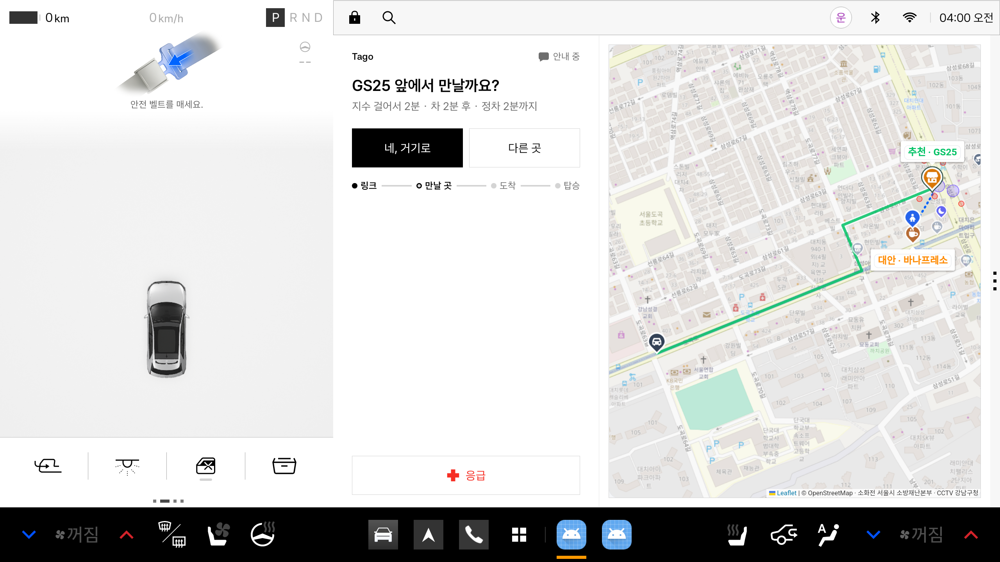
</p>

> **그림 1. 타고 픽업 차 화면(Pleos Connect 에뮬레이터).**
> - **맨 위 질문** "GS25 앞에서 만날까요? · 지수 걸어서 2분 · 차 2분 후 · 정차 2분까지"가 운전 중에 한 문장으로 읽어 주는 제안이다. 운전자는 [네, 거기로]를 누르거나 "응"이라고 말하면 된다.
> - **진행 줄**(링크 → 만날 곳 → 도착 → 탑승)은 기다리는 사람의 휴대폰 화면과 같은 단계를 보여 준다.
> - **오른쪽 지도**에는 추천(초록)과 대안(주황), 차가 갈 길이 그려진다. 빨간 원은 소화전·버스정류장·횡단보도 같은 정차 금지 반경이다.
> - 화면 문법(흑백·직각)은 Pleos 순정 설정 화면을 따랐다.

## 요약

**배경.** 아이·어르신을 데리러 가는 차는 만남 지점 앞에 잠시 서야 한다. 그러나 횡단보도·버스정류장·소화전·어린이보호구역 근처는 정차 자체가 금지되고(도로교통법 제32조), 강남구 고정형 단속 CCTV 는 5분 이상 정차를 단속한다. 학원 정문은 하원 시간에 픽업 차량이 몰려 이중 정차가 생기는 곳이고, 아이·어르신이 큰길을 건너는 곳도 피해야 한다.

**방법.** 운전자가 차 화면 버튼이나 Gleo 음성으로 데리러 가기를 시작하면, 기다리는 사람에게 설치가 필요 없는 휴대폰 웹 링크가 만들어진다. 휴대폰이 위치를 공유하면 엔진이 450 m 안 후보에서 정차 금지·버스전용차로·큰길 횡단(아이·어르신)·정차 한도 초과를 **먼저 뺀다**. 남은 곳 가운데 차 이동 시간·걷는 부담·서로 기다리는 시간을 더한 비용이 가장 작은 곳을 한 문장으로 제안한다. 차가 확정 지점을 지나치면 운전자에게 묻지 않고 다음 지점으로 다시 정한다. 탑승은 2열 좌석·벨트·도어 신호로 차가 감지하고, 누가 탔는지는 휴대폰에서 본인이 확인한다. 같은 엔진을 PC(Python)와 차량 앱(Kotlin)에 두 번 구현하고 대조 스크립트로 출력이 같은지 검사한다.

**결과.** 두 엔진 대조는 대치동 12/12, 해외 3지역 각 5/5, 잘못된 입력 29/29(4지역)로 모두 일치했다. release APK 로 처음부터 끝까지(시작 → 위치 공유 → 음성 제안 → 확정 → 주행 → 도착 → 2열 도어 → 탑승)가 통과했다(10-24). 오류 입력 5종에 두 서버 모두 400 또는 무시로 답했고, HTML 주입은 글자로만 표시됐다. 픽업 제안 중 메모리(PSS)는 debug 174 MB·qa 117 MB 로 Pleos 기준 400 MB 이하다.

**한계.** 링크의 실제 전달(문자·푸시), 실제 주문·결제, 공개 HTTPS 서버, 인증은 구현하지 않았다. 실차의 안전벨트 탑승 판정과 Gleo 실제 음성 호출은 확인하지 못했다.

| 항목 | 내용 |
|---|---|
| 앱 이름 | 타고 픽업 (Tago Pickup), 패키지 `ai.meeos.tago` |
| APK | [`apk/Meeos_TagoPickup_release.apk`](apk/) — 엔진과 웹 페이지를 앱 안에 넣어 단독 실행 |
| 개발 보고서 | 접수 서류로 별도 제출 |
| 시연 영상 | [`docs/tago_pickup_demo.mp4`](docs/tago_pickup_demo.mp4) (1분 53초, 5.6 MB) |

## 목차

1. [개요](#1-개요)
2. [시스템 구성](#2-시스템-구성)
3. [만남 지점 엔진](#3-만남-지점-엔진)
4. [마지막 50 m](#4-마지막-50-m)
5. [검증](#5-검증)
6. [실행 방법](#6-실행-방법)
7. [저장소 구성](#7-저장소-구성)
8. [한계와 남은 일](#8-한계와-남은-일)
9. [데이터 출처와 라이선스](#9-데이터-출처와-라이선스)

## 1. 개요

### 1.1 설계 원칙

1. **법규 금지는 점수가 아니라 제외다.** 정차가 금지된 곳은 아무리 가까워도 후보에서 뺀다.
2. **사람마다 다른 곳.** 같은 학원 앞이라도 아이·성인·어르신, 비, 시각에 따라 만날 곳이 달라진다.
3. **운전자에게는 한 문장.** 제안·확정·도착·탑승 안내는 내비 안내체 한 문장이고, 이유는 화면에서만 길게 보여 준다.
4. **차가 아는 것과 사람이 아는 것을 나눈다.** 좌석·문 신호로는 "누가" 탔는지 모른다. 그래서 차는 "2열 오른쪽 탑승 감지"까지만 말하고, 본인 확인은 휴대폰에서 받는다.

### 1.2 화면 한눈에 보기

<table>
<tr>
<td width="50%">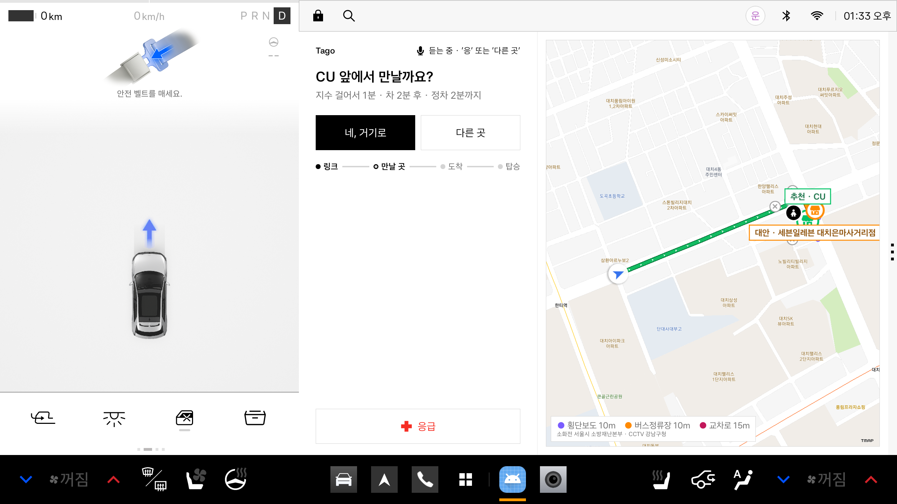</td>
<td width="50%">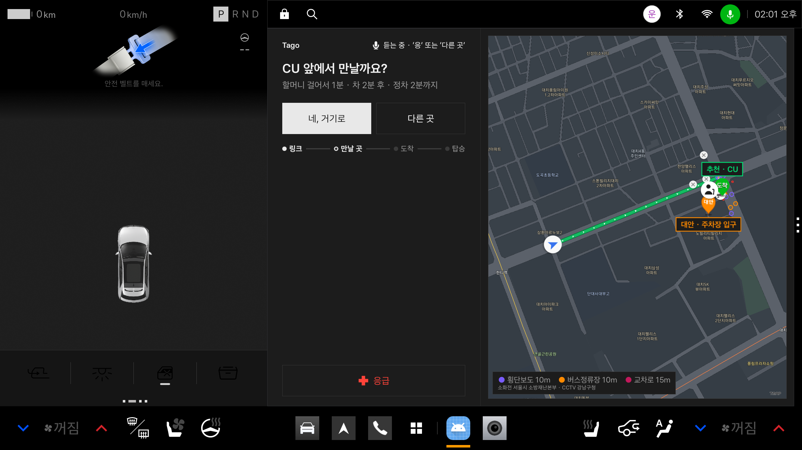</td>
</tr>
<tr>
<td><b>(a) 아이에게 맞춘 제안.</b> "CU 앞에서 만날까요? · 지수 걸어서 1분 · 차 2분 후 · 정차 2분까지". 대안은 세븐일레븐이다. 지도 아래 범례는 정차 금지 반경(횡단보도 10 m·버스정류장 10 m·교차로 15 m)이다.</td>
<td><b>(b) 다크 테마, 어르신.</b> 할머니를 데리러 갈 때의 제안이다. "CU 앞에서 만날까요? · 할머니 걸어서 1분", 대안은 주차장 입구다. 어르신은 걷는 부담을 2.5배로 보기 때문에 걷는 거리가 짧은 곳이 앞선다.</td>
</tr>
</table>

<table>
<tr>
<td align="center" width="25%">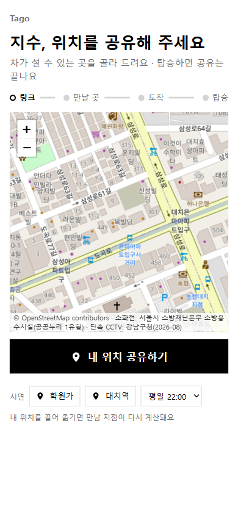</td>
<td align="center" width="25%">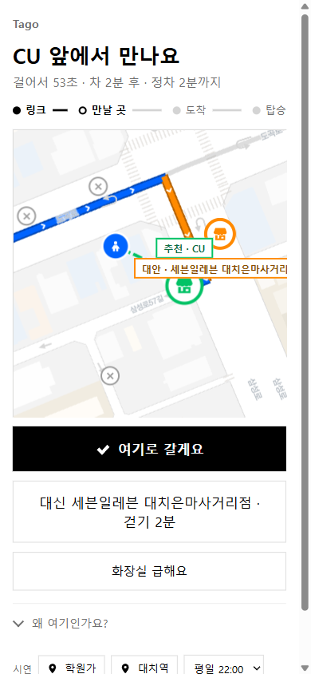</td>
<td align="center" width="25%">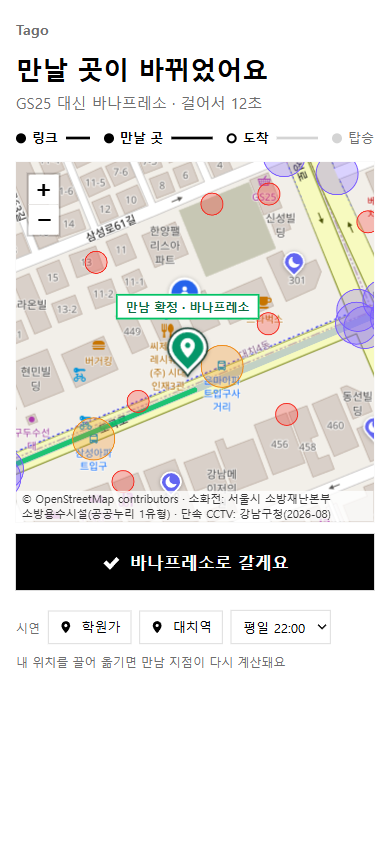</td>
<td align="center" width="25%">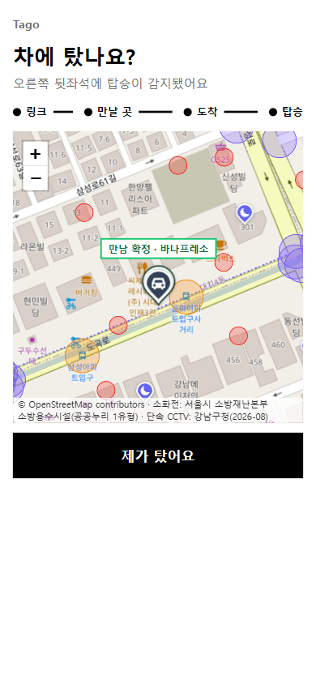</td>
</tr>
<tr>
<td><b>(c) 위치 공유.</b> 링크를 연 사람에게 위치 공유 한 번만 묻는다. 설치는 없다.</td>
<td><b>(d) 제안.</b> 추천과 대안 1곳, 걸어서 몇 분·차 몇 분 뒤·정차 몇 분까지를 보여 준다.</td>
<td><b>(e) 다시 약속.</b> 차가 자리가 막혀 지나치면 새 곳과 [확인했어요] 버튼이 뜬다.</td>
<td><b>(f) 탑승 확인.</b> 차는 "2열 오른쪽 탑승 감지"까지만 안다. 누가 탔는지는 [제가 탔어요]로 본인이 확인한다.</td>
</tr>
</table>

> **그림 2. 주요 화면.** (a)(b)는 차 화면(2560×1440 에뮬레이터 캡처), (c)~(f)는 기다리는 사람의 휴대폰 웹 화면(390×844)이다. 휴대폰 화면도 차 화면과 같은 문법(상태 한 줄 → 진행 단계 → 지도 → 버튼)을 쓴다.

### 1.3 누가 무엇을 하나

<p align="center">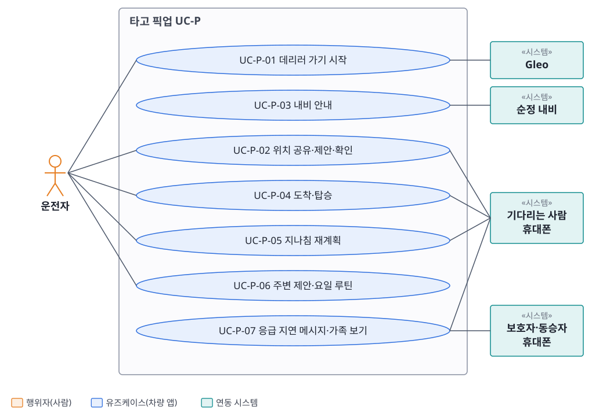</p>

> **그림 3. 유즈케이스(UC-P).** 운전자가 데리러 가기를 시작하면(UC-P-01, Gleo 음성 또는 버튼) 기다리는 사람의 휴대폰이 위치를 공유하고 제안을 확인한다(UC-P-02). 확정 지점으로는 순정 내비가 안내하고(UC-P-03), 도착·탑승(UC-P-04)과 지나침 재계획(UC-P-05)은 차 신호로 진행된다. 주변 제안·요일 루틴(UC-P-06)은 차가 먼저 묻는 기능이다. 보호자·동승자는 조작 없이 보기만 하는 화면으로 따라온다.

## 2. 시스템 구성

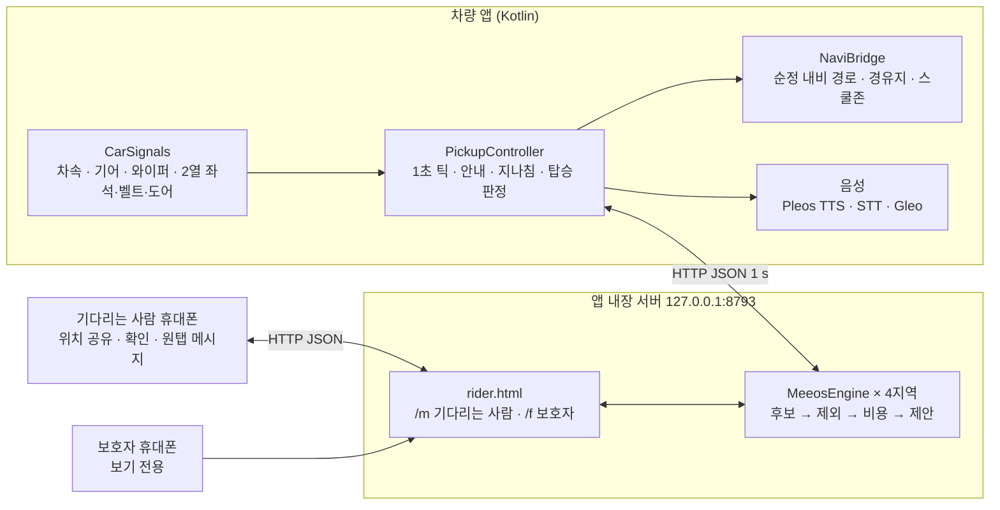

> **그림 4. 구성 요소와 데이터 흐름.** 차량 앱은 엔진을 직접 부르지 않고 HTTP 로만 접근한다. 그래서 앱 내장 서버와 PC 서버(`server/meeos_server.py`)를 갈아 끼울 수 있고, 두 구현이 같은 결과를 내는지 대조할 수 있다. 앱 내장 서버는 지역 4개(대치동·어바인·마컴·구루그람)의 엔진을 들고 세션 id 로 고른다. 기다리는 사람과 보호자는 같은 서버가 내주는 웹 페이지를 휴대폰 브라우저로 연다.

<p align="center">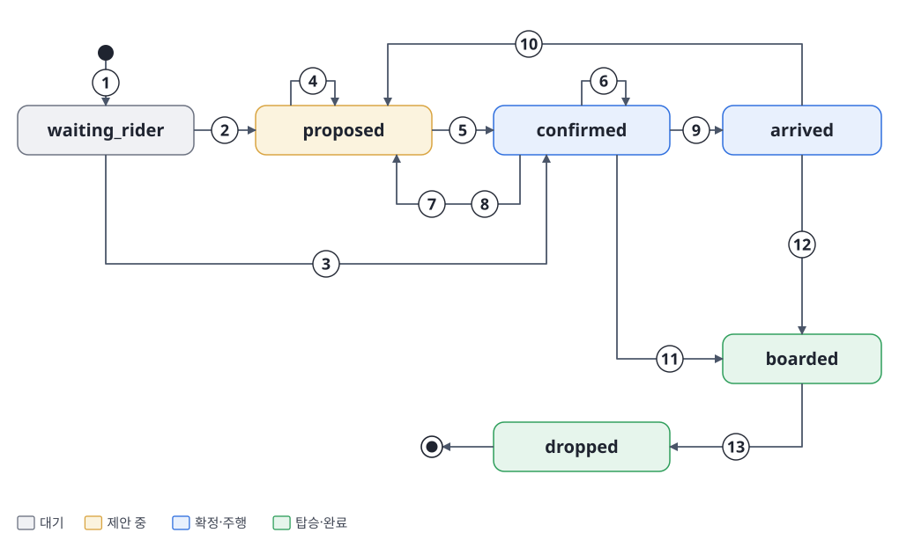</p>

> **그림 5. 픽업 세션 상태.** 세션은 waiting_rider(링크 보냄) → proposed(제안) → confirmed(확정) → arrived(도착) → boarded(탑승) → dropped(하차)로 진행한다. 제안 중에는 갱신할 때마다 다시 평가해 1순위가 바뀌면 제안을 바꾸고(4), 확정 뒤에는 도착 시간만 계산한다(6). 차가 확정 지점을 지나치면 confirmed 에서 다시 proposed 를 거쳐 자동 확정된다(7·8). 도착 전에 탔다면 confirmed 에서 바로 boarded 로 간다(11).

## 3. 만남 지점 엔진

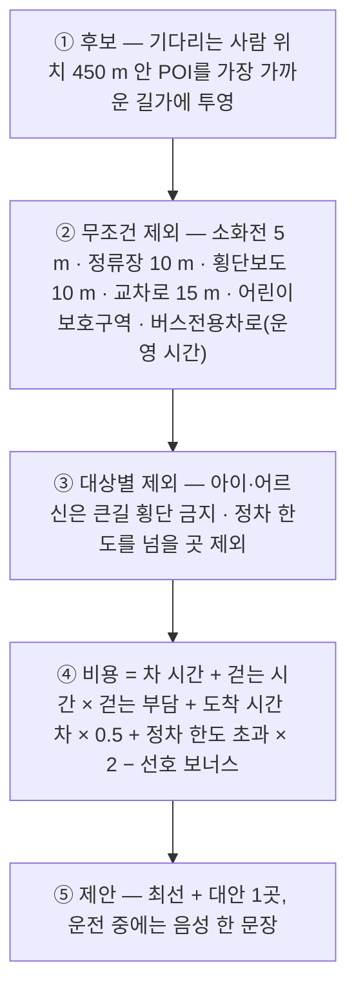

> **그림 6. 만남 지점을 고르는 순서.**
> - **법규 금지는 먼저 뺀다.** 차체 일부만 걸려도 위반이라 반경에 차 길이 절반(2.5 m)을 더한다. 소화전은 서울시 소방용수시설 실데이터, 나머지는 OpenStreetMap 이다.
> - **정차 한도.** 기본 5분이다. 100 m 안에 지금 운영 중인 단속 CCTV 가 있으면 4분, 하원 집중 단속 시간(21~23시)에는 2분으로 줄인다.
> - **걷는 부담.** 아이 ×1.3, 성인 ×1.0, 어르신 ×2.5 이고, 비가 오면(와이퍼) ×1.5 다.
> - **선호.** 아이는 편의점·지하철 출구처럼 밝고 사람 많은 곳을, 어르신은 앉아서 기다릴 수 있는 카페·약국을 조금 우대한다. 밤(19~06시)에는 보안등·CCTV·안심벨이 가까운 곳을 조금 우대한다.
> - **안내.** 운전 중 음성은 "정차 금지 22곳 제외. 지수가 큰길을 건너지 않는 GS25 앞을 제안합니다. 안내할까요?" 한 문장이다. 화면에는 가장 가까운 법규 제외 사례부터 설명한다("바로 옆 스타벅스는 소화전과 7m 거리라 제외했습니다").

<p align="center"></p>

> **그림 7. 같은 학원 앞, 사람·날씨에 따라 바뀌는 만남 지점(평일 22:00, 대치동 학원가).** 왼쪽부터 아이·성인·어르신·아이+비다. 아이에게는 큰길을 건너지 않는 밝은 GS25, 성인에게는 길을 건너도 차가 빨리 닿는 빽다방, 어르신에게는 걷기 짧은 바나프레소가 추천된다. 비가 오면 아이에게도 지붕이 있는 바나프레소가 추천된다. 네 경우 모두 "바로 옆 스타벅스는 소화전과 7m 거리라 뺐어요"가 같이 나온다.

**해외 지역.** 같은 엔진이 지역 프로필(`server/regions/<id>.json`)로 미국 어바인·캐나다 마컴·인도 구루그람의 정차 규칙을 적용한다. 규칙마다 '정차 금지(후보 제외)'와 '주차만 금지(바로 태움, 정차 한도 60초)'를 구분하고, 음성·버튼·응급 번호(119 / 911 / 112)가 지역에 맞게 바뀐다.

## 4. 마지막 50 m

<table>
<tr>
<td width="50%">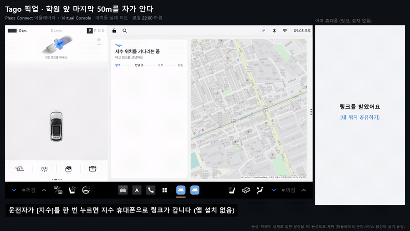</td>
<td width="50%">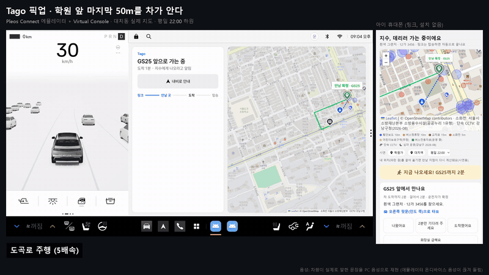</td>
</tr>
<tr>
<td><b>그림 8(a). 제안 → 확정(2배속).</b> 기다리는 사람(지수)이 위치를 공유하면 차가 정차 금지 22곳을 빼고 큰길을 건너지 않는 GS25 를 제안한다. 운전자가 "응" 하면 지수 휴대폰에 "지금 나오세요"와 "오른쪽 뒷문(인도 쪽)으로 타요"가 뜬다.</td>
<td><b>그림 8(b). 지나침 → 재약속 → 탑승(3배속).</b> 자리가 막혀 GS25 를 지나치자 엔진이 지나온 곳을 빼고 GS25 대치학원점으로 <b>묻지 않고</b> 다시 정한다. 지수가 [확인했어요]를 누르면 차가 알려 준다. 도착 뒤 차도 쪽 문이 열리면 인도 쪽 문을 한 번 더 안내한다. 2열 문이 열렸다 닫히면 "탑승 감지", 지수가 [제가 탔어요]를 누르면 "탑승 확인"이 된다.</td>
</tr>
</table>

> 그림 8 은 시연 영상([`docs/tago_pickup_demo.mp4`](docs/tago_pickup_demo.mp4), 2026-10-29, 1분 53초)에서 잘랐다. 차 화면은 에뮬레이터 녹화, 오른쪽 휴대폰은 같은 세션의 웹 페이지다. 영상을 찍은 뒤 휴대폰 화면 디자인이 그림 2(c)~(f)처럼 바뀌었다.

- **지나침 → 자동 재약속.** 확정 지점에서 서지 못하고(2 m/s 넘게) 80 m 넘게 지나가면 앱이 엔진에 알린다. 엔진은 그 지점과 이미 지나온 곳을 빼고 지금 차 위치에서 다시 골라 **묻지 않고 바로 확정**한다. 운전 중이라 운전자에게는 다시 묻지 않지만, 아이가 봤는지는 [확인했어요]로 따로 받고, 30초 안에 확인이 없으면 "예전 지점 쪽도 살펴봐 주세요"라고 알린다.
- **탈 문 미리 안내.** 차가 어느 쪽 길가에 설지는 엔진이 안다. 휴대폰에 "오른쪽 뒷문(인도 쪽)으로 타요"를 띄우고, 그래도 차도 쪽 문이 열리면 한 번 더 말한다.
- **2열 전 좌석으로 탑승 판정.** 2열 세 좌석의 착석·벨트와 양쪽 문을 읽는다. 확정 순간의 벨트 상태를 기억해 두고, 그 뒤의 변화만 탑승으로 센다.
- **순정 기능과 역할 나누기.** 안전 하차 경고·후석 승객 알림·뒷좌석 벨트 경고는 순정에 이미 있다. 그래서 타고 픽업은 다가오는 차 경고를 하지 않고, **어느 문으로 탈지**와 **탑승 기록**만 맡는다.
- **원탭 메시지.** 기다리는 사람이 [나왔어요]·[2분만 기다려 주세요]·[도착했어요]를 누르면 차가 "지수 메시지입니다. 나왔어요"처럼 읽어 준다. 운전자는 답하지 않아도 된다.

## 5. 검증

| 무엇을 | 어떻게 | 결과 | 근거 |
|---|---|---|---|
| 두 엔진 일치 | PC `meeos_server.py` ↔ 앱 `MeeosEngine.kt` 같은 입력 대조 | 대치동 12/12, 해외 3지역 각 5/5, 잘못된 입력 29/29(4지역) | `server/check_parity.py` |
| 처음부터 끝까지 | release APK, 시작 → 공유 → 음성 제안 → 확정 → 주행 → 도착 → 2열 도어 → 탑승 | 통과(10-24) | 시연 영상 |
| 해외 지역 | 어바인 영어 제안 → 확정 → 화장실 재제안 → 드라이브스루 | 통과(10-25) | 개발 보고서 |
| 오류 입력 | 잘못된 본문 5종, HTML 주입 | 두 서버 모두 400 또는 무시, 주입은 글자로만 표시 | 개발 보고서 |
| 메모리 | 픽업 제안 중 PSS | debug 174 MB · qa 117 MB(Pleos 기준 400 MB 이하) | 개발 보고서 |
| 단위 시험 | 순수 로직(JUnit 4, 로컬 JVM) | 통과 | `app/src/test/` |

> **표 읽는 법.** '두 엔진 일치'는 같은 입력에 대해 PC 엔진과 앱 내장 엔진의 출력(추천·이유 문장·제외 목록·정차 한도)이 같은지를 센 것이다. 규칙을 한쪽만 고치면 이 숫자가 깨진다. 실측 행은 모두 x86_64 에뮬레이터 값이며 실차 값이 아니다.

## 6. 실행 방법

**필요한 것**
- Pleos Connect 에뮬레이터(Android Automotive 14 / API 34, x86_64)와 Virtual Console
- 소스 빌드: JDK 17, Android SDK 37(compileSdk 37 · targetSdk 35), 저장소의 Gradle Wrapper(이 저장소의 기본 빌드는 픽업 판이다: `gradle.properties` 의 `meeos.edition=pickup`)
- PC 서버(선택): Python 3.10 이상(표준 라이브러리만 사용)
- 지도 타일·CDN 을 받기 위한 인터넷 연결

**설치와 실행.** 엔진과 웹 페이지가 앱 안에서 돈다.

```bash
adb install -r -g apk/Meeos_TagoPickup_release.apk
```

`-g` 는 차 속도 런타임 권한을 함께 준다(음성 인식은 Pleos 음성 SDK 가 맡아 이 앱이 마이크 권한을 묻지 않는다). 차 화면에서 가족(지수·엄마·할머니)을 고르면 데리러 가기가 시작된다. 앱 목록의 이름은 'Tago' 다.

**앱 안 서버 포트가 이미 쓰이고 있을 때.** 앱 안 서버는 포트 8793 을 쓴다. 다른 프로그램이 이 포트를 먼저 잡고 있으면 앱은 지도 자리와 토스트에 '앱 안 서버를 열지 못했습니다(포트 8793 사용 중)…'를 띄우고 데리러 가기를 시작하지 않는다(`adb logcat -s Meeos` 에 '내장 서버 시작 실패'). 그 프로그램을 끄고(`adb shell am force-stop <그 앱 패키지>`) 이 앱을 다시 연다.

**새 에뮬레이터에서 첫 실행이 권한 대화상자에서 멈출 때.** Android Automotive 는 앱을 운전자 사용자(보통 10번)에서 돌려 `-g` 가 그 사용자에게 닿지 않을 수 있다(새로 만든 에뮬레이터 첫 설치에서 실제로 멈춘 기록이 있다). 사용자 번호를 확인하고, 다르면 아래의 `10` 을 그 값으로 바꾼다. 권한을 준 뒤 앱을 다시 연다. 이 판의 런타임 권한은 이것 하나다.

```bash
adb shell am get-current-user
```
```bash
adb shell pm grant --user 10 ai.meeos.tago android.car.permission.CAR_SPEED
```

**Virtual Console 열기.** 페달·기어·문·방향지시는 에뮬레이터의 Virtual Console 웹 화면으로 조작한다. 포트를 연 뒤 PC 브라우저에서 `http://127.0.0.1:8088/` 을 연다. 창이 작거나(1600×900 미만) 다른 창에 가려지면 페달 조작이 먹지 않을 수 있다.

```bash
adb forward tcp:8088 tcp:8088
```

에뮬레이터의 순정 내비 현재 위치는 한 곳에 고정돼 있어, [내비로 안내]를 누르면 만남 지점까지 시연 지역과 무관한 먼 경로가 잡힐 수 있다. 음성으로 답하려면 PC 마이크를 에뮬레이터에 연결한다(버튼으로도 답할 수 있다).

```bash
adb emu avd hostmicon
```

**기다리는 사람 화면 보기.** 앱 내장 서버를 PC 로 연다.

```bash
adb forward tcp:8791 tcp:8793
```

PC 브라우저(휴대폰 크기)에서 `http://127.0.0.1:8791/m/<세션>` 을 연다. 링크는 `adb logcat -s Meeos` 에 뜬다(이 기록은 심사용 빌드 — 시연 훅 포함 — 에서만 찍힌다). 보호자 보기는 `/f/<세션>` 이다.

**에뮬레이터 요령.** 에뮬레이터는 좌석 착석이 항상 true 이고 벨트 조작이 없어, 탑승은 2열 문 열림 → 모두 닫힘으로 판정한다. 벨트는 시연 인텐트로 넣는다.

```bash
adb shell am start -n ai.meeos.tago/.MainActivity --ez belt_sim true
```

**PC 서버와 두 엔진 대조.**

```bash
python server/meeos_server.py
```
```bash
python server/check_parity.py
```

**빌드.** 제출 APK 는 심사용 빌드(시연 훅 포함)다. 제품 빌드는 옵션 없이 빌드하며, 이때는 시연 인텐트(위의 벨트 시연 포함)·링크 기록이 꺼진다.

```bash
./gradlew assembleRelease -Pmeeos.edition=pickup -Pmeeos.demo=true
```
```bash
./gradlew assembleRelease -Pmeeos.edition=pickup
```

## 7. 저장소 구성

| 위치 | 역할 |
|---|---|
| `app/` | 차량 앱(Kotlin, Jetpack Compose). `pickup/` 데리러 가기, `car/` 차량 신호, `voice/` TTS·STT·Gleo, `navi/` 순정 내비, `engine/` 앱 내장 엔진(`MeeosEngine.kt`)과 HTTP 서버, `ui/` 화면 |
| `apk/` | 제출 release APK |
| `server/` | PC 엔진(`meeos_server.py`), 기다리는 사람·보호자 웹(`rider.html`), 대치동 지도·CCTV·주변 장소 데이터와 빌드·수집 스크립트, 두 엔진 대조(`check_parity.py`) |
| `server/regions/`, `server/global/` | 해외 지역 정차 규칙 프로필과 동네 지도 |
| `docs/` | 캡처·움짤·시연 영상 |

**문서 안내.**
- 처음 보는 사람: 이 README → [시연 영상](docs/tago_pickup_demo.mp4) → 개발 보고서(접수 서류로 별도 제출)
- 데이터 출처: [DATA_SOURCES.md](DATA_SOURCES.md)

이 저장소의 앱 소스는 같은 코드에서 Gradle 판 분기(`meeos.edition`, `BuildConfig`)로 여러 판을 만드는 구조라, 이 판에서 꺼지는 기능의 코드도 함께 들어 있다. 이 저장소의 기본 빌드와 제출 APK 는 픽업 판이다.

## 8. 한계와 남은 일

- **실차 검증 없음.** 모든 측정은 x86_64 에뮬레이터 값이다. 실차의 안전벨트 탑승 판정과 Gleo 실제 음성 호출은 확인하지 못했다.
- **링크 전달.** 링크는 지금 로그에만 나온다. 문자·푸시로 실제 보내는 기능은 없다.
- **주문·결제.** 드라이브스루·포장 주문은 목업이다. 매장 주문 시스템과 차량 결제 SDK 가 없어 실제 주문·결제는 하지 않는다.
- **서버·보안.** 공개 HTTPS 서버와 인증이 없다. 내장 서버는 루프백 전용이다.
- **법적 절차.** 실제 서비스는 위치기반서비스사업 신고와 개인위치정보 동의, 14세 미만은 법정대리인 동의가 필요하다. 시연 범위에서는 구현하지 않았다.

## 9. 데이터 출처와 라이선스

- 지도·공공데이터의 출처와 이용 조건: [DATA_SOURCES.md](DATA_SOURCES.md) — OpenStreetMap ODbL, 서울시 소방용수시설·공영주차장·역 화장실·안심귀갓길(공공누리 1유형), 강남구 단속 CCTV 현황 등
- 지도 화면 아래의 표기(© OpenStreetMap contributors 등)는 각 이용 조건을 따른 것이다.
